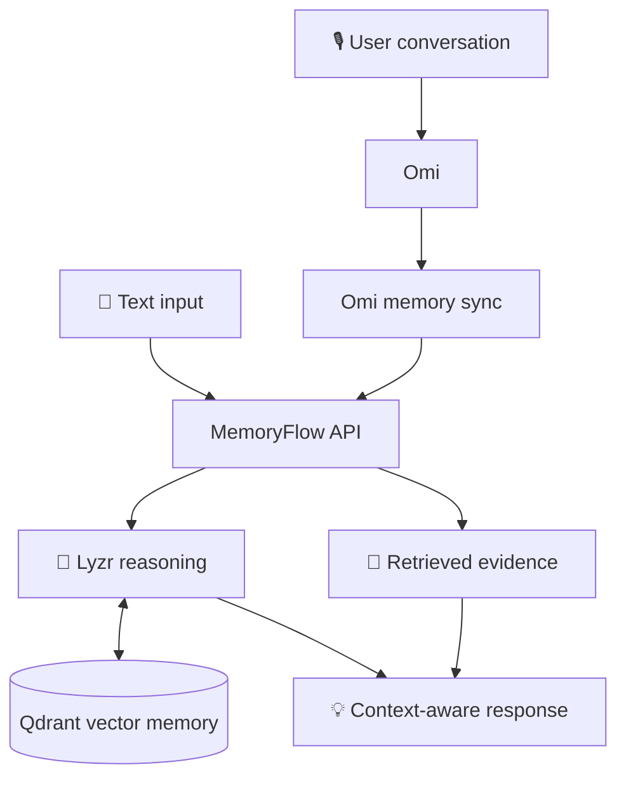

# 🧠 MemoryFlow
### Conversations into context. Context into clarity.

<p align="center">
  An AI-powered conversational memory system that helps turn scattered conversations into searchable, reusable knowledge.
</p>

<p align="center">
  
  
  
  
  
</p>

<p align="center">
  <b>Build Track:</b> Collaborative Multi-Agent Workflows
</p>

---

## ✨ The idea

Important information gets buried in conversations. MemoryFlow aims to make that information useful again by connecting conversational input, persistent vector memory, and AI-powered reasoning in one workflow.

Instead of treating every interaction as isolated, MemoryFlow lets users save information, retrieve relevant context, and inspect the evidence behind recalled answers.

## 🚀 What it does

| 🧠 Persistent memory | 🔎 Contextual recall |
|---|---|
| Store useful facts from conversations. | Retrieve relevant information from saved memories. |

| 🎙️ Omi integration | 🤖 AI reasoning |
|---|---|
| Bring conversational information into the workflow through Omi. | Use Lyzr integration to support context-aware reasoning. |

| 📚 Evidence-backed answers | 🔄 Memory synchronization |
|---|---|
| Inspect retrieved evidence supporting a response. | Synchronize available Omi memories into the system. |

## 🏗️ How it works



### The workflow

1. **Capture** — Bring information into MemoryFlow through text input or the Omi integration.
2. **Process** — The FastAPI backend coordinates the memory workflow.
3. **Retrieve** — Qdrant stores and retrieves relevant information using vector search.
4. **Reason** — The Lyzr integration supports reasoning over the available context.
5. **Respond** — Return a response with supporting retrieved evidence where available.

## 🛠️ Technology stack

| Layer | Technology | Purpose |
|---|---|---|
| Interface | HTML, CSS, JavaScript | Interactive MemoryFlow experience |
| Backend | Python, FastAPI | API and workflow coordination |
| Persistent memory | Qdrant | Vector-based memory retrieval |
| Agent reasoning | Lyzr | AI reasoning integration |
| Conversational input | Omi | Voice and conversation memory integration |

## 🖥️ Product walkthrough

The application provides four main views:

- **Welcome** — Introduction to MemoryFlow.
- **Overview** — Entry point for the memory workflow.
- **Memory Vault** — Work with stored conversational memories.
- **Recall Studio** — Ask questions and inspect retrieved context.

## ⚡ Getting started

### Prerequisites

- Python 3.11
- API credentials for the integrations you intend to use
- A configured Qdrant instance

### 1. Clone the repository

```bash
git clone https://github.com/BasutkarSony/MemoryFlow-AI.git
cd MemoryFlow
```

### 2. Create and activate a virtual environment

**Windows CMD**

```cmd
python -m venv venv
venv\Scripts\activate
```

### 3. Install dependencies

```cmd
pip install -r requirements.txt
```

### 4. Configure environment variables

Copy the example configuration:

```cmd
copy .env.example .env
```

Set the required values in `.env`:

```env
OMI_API_KEY=your_omi_api_key
QDRANT_URL=your_qdrant_url
QDRANT_API_KEY=your_qdrant_api_key
LYZR_API_KEY=your_lyzr_api_key
```

Use your own credentials. **Never commit `.env` or expose API keys in screenshots, logs, or public documentation.**

### 5. Start MemoryFlow

```cmd
uvicorn backend.main:app --host 127.0.0.1 --port 8000
```

Open the application at:

**http://127.0.0.1:8000**

## 🔌 API reference

| Endpoint | Method | Purpose |
|---|---|---|
| `/health` | `GET` | Check service and integration configuration |
| `/process` | `POST` | Process a memory interaction |
| `/omi/sync` | `POST` | Synchronize available Omi memories |

### Check the service

```cmd
curl http://127.0.0.1:8000/health
```

### Example: save a memory

```cmd
curl -X POST http://127.0.0.1:8000/process -H "Content-Type: application/json" -d "{\"message\":\"My meeting room is Cedar at 3:30 PM\",\"intent\":\"remember\"}"
```

### Example: recall information

```cmd
curl -X POST http://127.0.0.1:8000/process -H "Content-Type: application/json" -d "{\"message\":\"Which meeting room did I mention?\",\"intent\":\"recall\"}"
```

The exact request and response fields should match the current backend implementation.

## 🧪 Evaluation

Memory retrieval quality matters as much as generating an answer. MemoryFlow includes a retrieval evaluation script:

```cmd
python scripts/evaluate_memory.py
```

Use the evaluation output to inspect retrieval relevance and identify opportunities to improve memory matching.

## 🔐 Security

- Keep API credentials in local environment configuration.
- Exclude `.env`, virtual environments, and generated cache files from version control.
- Avoid storing sensitive personal information unless the deployment and data-handling setup is appropriate for it.
- Verify that deployment settings do not expose private credentials or internal service details.

## 🗺️ Project architecture

```text
MemoryFlow/
├── backend/
│   ├── main.py
│   ├── agent_core.py
│   ├── lyzr.py
│   ├── omi.py
│   └── qdrant_memory.py
├── frontend/
│   ├── index.html
│   ├── styles.css
│   └── app.js
├── scripts/
│   └── evaluate_memory.py
├── .env.example
├── .gitignore
├── requirements.txt
└── README.md
```

## 🌟 Why MemoryFlow?

MemoryFlow brings together conversational information, persistent vector retrieval, and AI reasoning to make useful context easier to revisit.

**The goal: spend less time repeating information and more time using it.**

---

<p align="center">
  <b>MemoryFlow</b><br/>
  <i>Conversations into context. Context into clarity.</i>
</p>
